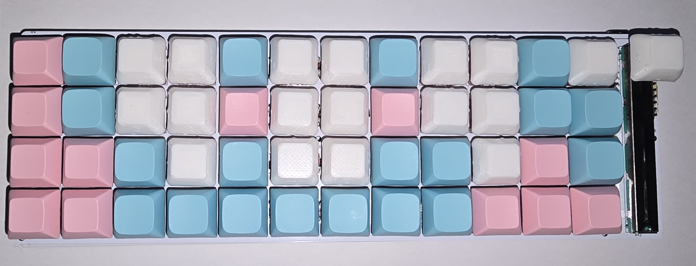
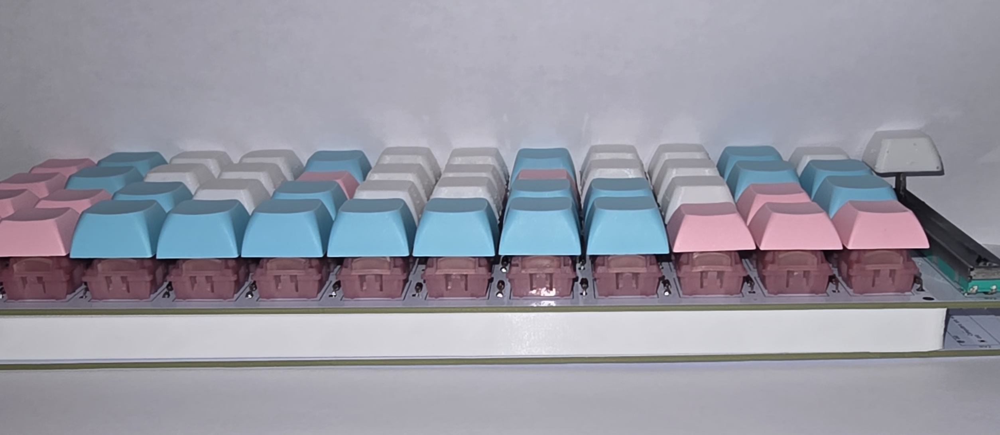
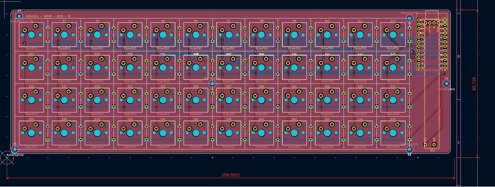

# 40-MOS (40-MathylleinOrtholinearSlider)
---

## 📐 Layout
- Ortholinear **4x12 grid**
- Extra right-side **slider potentiometer**
- Pro Micro (USB-C) placed top-right under the slider

---

## 💻 Firmware
- Base firmware: [QMK](https://qmk.fm/)  
- Configurable with [VIA](https://usevia.app/) or [Vial](https://get.vial.today/)  
- Potentiometer support included in firmware (mapped as analog input)

---

## 🖨️ Case Options
- **Sandwich case** (DXF / SVG files included)
- **3D printed case** (not tested) (STL files included)

---

## 🚀 Getting Started
1. Flash QMK firmware to your Pro Micro (USB-C).
2. Assemble PCB with switches, diodes, and potentiometer.
3. Mount in sandwich or 3D printed case.
4. Configure keymap in VIA/Vial or recompile with QMK.

---

## 🔌 Pro Micro Pinout (Matrix)

| **Row / Col** | **Pin** |
|---------------|---------|
| Row 0         | D0      |
| Row 1         | D1      |
| Row 2         | D2      |
| Row 3         | D3      |
| Col 0         | D4      |
| Col 1         | C6      |
| Col 2         | D7      |
| Col 3         | E6      |
| Col 4         | B4      |
| Col 5         | B5      |
| Col 6         | B6      |
| Col 7         | B2      |
| Col 8         | B3      |
| Col 9         | B1      |
| Col 10        | F7      |
| Col 11        | F6      |

*(Pro Micro USB-C top-right under the slider)*  

---

## 📸 Gallery

---

## 🔮 Future Updates / Ideas
- 💡 **Backlight LEDs** under switches  
- 🔔 **Layer indicator LEDs** (different colors per layer)  
- 🔄 **Hot-swap sockets** (instead of soldering switches directly)  
- 📏 **SMD components** (instead of THT for a cleaner build)  
- ✨ **Edge/sandwich LEDs** between plates for an underglow effect  
- 🎛️ **Extra potentiometers or rotary encoders** for more controls  

---

## 🙏 Special Thanks
- [**MiPSR**](https://github.com/MiPSR) → inspiration, guidance, and shared knowledge :3
