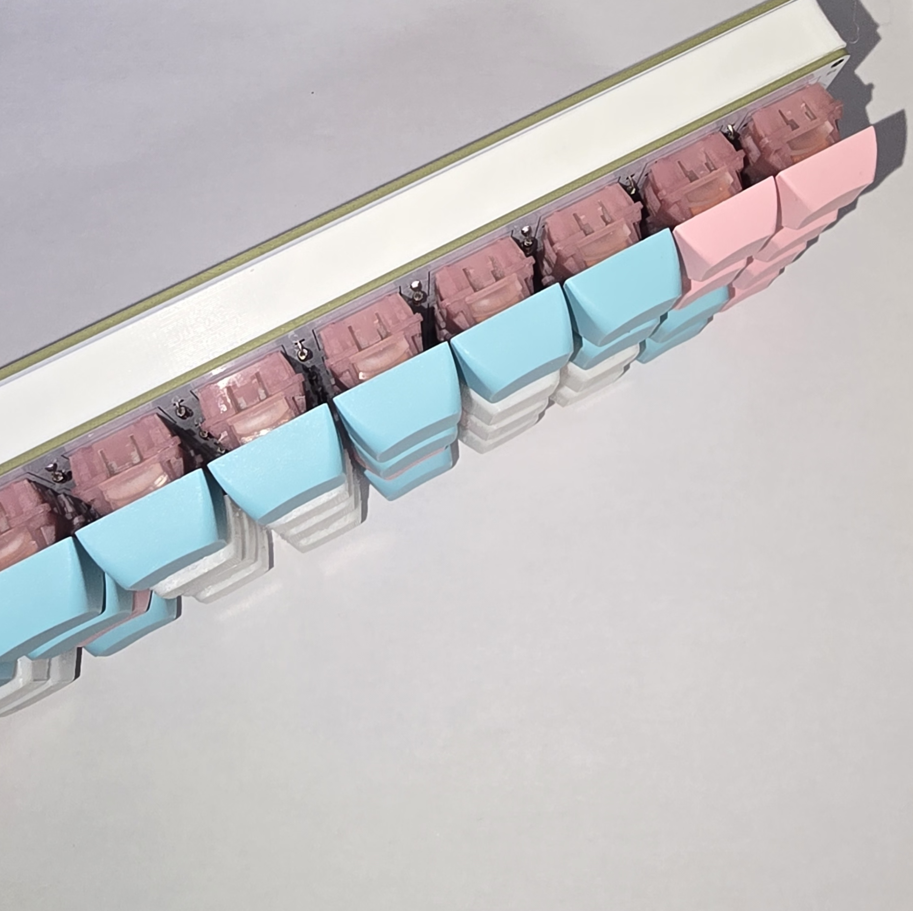
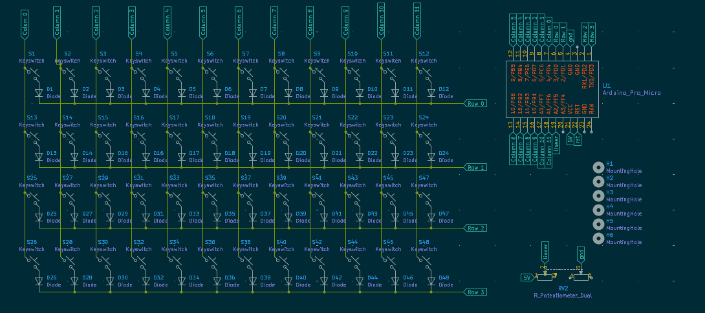
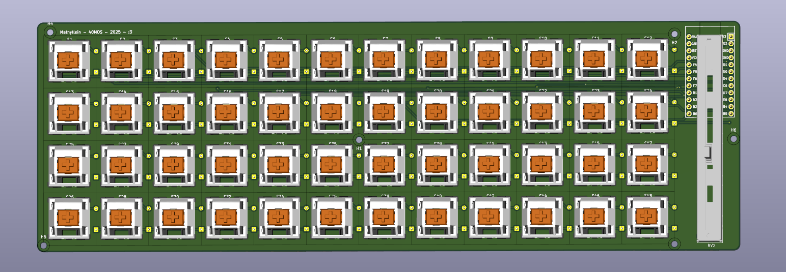

# 40-MOS (40-Mathyllein Ortholinear Slider)

A 40% ortholinear keyboard (4x12) with a slider potentiometer on the right side.

## Overview

- 4x12 ortholinear layout
- Slide potentiometer on the right
- Pro Micro (USB-C), sitting top-right under the slider
- Runs QMK, configurable with VIA or Vial

## Firmware

The board runs [QMK](https://qmk.fm/) and the keymap can be changed with [VIA](https://usevia.app/) or [Vial](https://get.vial.today/).

Slider support (read as an analog input) isn't in the firmware yet. I'll add it when I get the time.

## Case

Two options are included:

- Sandwich case (DXF / SVG files)
- 3D printed case (STL files). I haven't printed or tested this one yet.

## Build

1. Flash QMK onto the Pro Micro.
2. Solder the switches, diodes and the potentiometer to the PCB.
3. Put everything in the case of your choice.
4. Set up your keymap in VIA/Vial, or edit it and recompile with QMK.

## Pinout

| Row / Col | Pin |
|-----------|-----|
| Row 0     | D0  |
| Row 1     | D1  |
| Row 2     | D2  |
| Row 3     | D3  |
| Col 0     | D4  |
| Col 1     | C6  |
| Col 2     | D7  |
| Col 3     | E6  |
| Col 4     | B4  |
| Col 5     | B5  |
| Col 6     | B6  |
| Col 7     | B2  |
| Col 8     | B3  |
| Col 9     | B1  |
| Col 10    | F7  |
| Col 11    | F6  |

## Pictures

## Ideas for later

Things I might add in a future revision:

- Per-key backlight
- LEDs showing the active layer, with a different color for each layer
- Hot-swap sockets, so switches don't need soldering
- SMD parts instead of through-hole
- Underglow LEDs between the sandwich plates
- More potentiometers or some rotary encoders

## Thanks

Thanks to [MiPSR](https://github.com/MiPSR) for the inspiration, the help and everything I learned along the way :3
